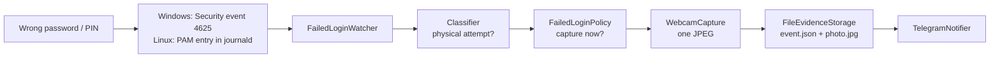

# Failed Login Security Monitor

A background service for **Windows and Linux** that detects failed login attempts on your own PC, tries to take a webcam photo, saves the evidence locally and sends a notification to your phone via Telegram.

On a dual-boot PC it can also act as a **login gate**: the PC always starts Linux, and a successful login by a configured user restarts the PC into Windows.

Built with C# / .NET 10 as a learning project, using only documented operating system mechanisms: the Windows Security event log, Linux PAM entries in the systemd journal, systemd, UEFI boot variables, the Windows `MediaCapture` camera API and the Telegram Bot API.

## What it does

When someone types a wrong password or PIN on the lock or login screen:

```
[22:01:29 INF] Relevant failed login detected: Pin, LogonType 2, user (unknown)
[22:01:29 WRN] Failed login threshold reached (1/1)
[22:01:29 INF] Attempting webcam capture
[22:01:29 WRN] Webcam capture failed: No camera found
[22:01:29 INF] Evidence saved to C:\ProgramData\SecurityMonitor\Evidence\2026-10-12\22-01-29
[22:01:30 INF] Telegram notification sent
```

A notification arrives on your phone, and each incident gets its own folder:

```
Evidence/
    2026-10-16/
        14-31-31/
            event.json
            photo.jpg      (only when a camera captured a photo)
```

`event.json` has common fields and a platform-specific block:

```json
{
  "timestamp": "2026-10-16T14:31:31.2245511+02:00",
  "authenticationMethod": "Password",
  "userName": "deni",
  "sourceNetworkAddress": null,
  "computerName": "deni-dualboot",
  "attemptsInWindow": 1,
  "captureSucceeded": false,
  "captureFailureReason": "Webcam capture is not implemented on Linux yet",
  "photoFile": null,
  "linux": {
    "service": "cinnamon-screensaver",
    "terminal": ":0"
  }
}
```

On Windows the block is `"windows"` with `eventId`, `logonType`, `domain`, `failureStatus`, `failureSubStatus` and `workstationName`.

## How it works



1. **Detection.**
   - Windows: subscribes to new **Event ID 4625** ("An account failed to log on") entries in the Security log.
   - Linux: follows the system journal (`journalctl --follow`, auth facility) and reads `pam_unix(...:auth): authentication failure` entries. If `journalctl` stops, it is started again automatically.
2. **Classification.** Only attempts made at the keyboard count:
   - Windows: Logon Type **2** (Interactive), **7** (Unlock) or **11** (CachedInteractive) from a local address. The Sub Status tells a wrong **PIN** (`0xC0000380`) from a wrong **password** (`0xC000006A`).
   - Linux: the login screen (`lightdm`) and the lock screen (`cinnamon-screensaver`) with no remote host.

   Network logons, services, scheduled tasks, Remote Desktop, `sudo` and `ssh` are ignored.
3. **Policy.** Configurable threshold, time window and cooldown decide when to capture. The default reacts to every relevant attempt.
4. **Capture.** One photo from the default webcam (Windows). Camera problems are recorded as a failed capture and never crash the app.
5. **Evidence.** Saved as JSON, plus the photo when there is one. Diagnostic logs are kept separately.
6. **Notification.** A Telegram message, with the photo when there is one. A throttle prevents spam but never drops evidence.

## Dual-boot login gate (Linux)

```
Power on → GRUB → Linux login screen (monitor already running as a systemd service)
   ├── wrong password (any user)      → evidence + Telegram
   ├── configured user (e.g. "deni")  → efibootmgr --bootnext <Windows> → reboot → Windows (once)
   └── any other user (e.g. "admin")  → stays in Linux
Windows shuts down or restarts        → BootNext is used up → Linux again
```

- A successful login is read from the journal: `pam_unix(lightdm:session): session opened for user ...`. Greeter, `systemd-user`, `sudo` and `cron` sessions and system accounts (uid < 1000) are ignored. Unlocking the lock screen does not open a session, so it never switches.
- The switch uses the UEFI **BootNext** variable, so Windows is started directly by the firmware (not chained through GRUB).
- **Fail-safe:** if anything goes wrong (no Windows entry, `efibootmgr` fails, the reboot fails, the service stops during the delay), the pending switch is cleared and the PC stays in Linux.
- **DryRun** mode logs what would happen without touching the firmware.
- Off by default. Nothing is registered and no second journal reader runs unless `DualBoot.Enabled` is `true`.

Status: verified end to end in a VirtualBox VM (Linux Mint 22.3 + Windows 11, UEFI). Not yet deployed on real hardware.

## Limitations

These are platform limits or known gaps, not hidden bugs:

- **Windows: only while you are signed in and the PC is locked.** The app runs in your user session (Task Scheduler at sign-in). Attempts on the sign-in screen after a restart are not seen, and a Windows Service cannot reliably use the camera (Session 0 isolation).
- **Windows: wrong PINs have no user name** in the event log. **Biometric failures** usually do not create event 4625.
- **Windows: webcam capture** is implemented and handles "no camera" and "access denied", but has not yet been verified with a real webcam. Camera privacy settings apply.
- **Linux: no webcam capture yet.** Evidence and Telegram work, the photo is missing.
- **Linux: other desktops.** Service names are those of Linux Mint Cinnamon (`lightdm`, `cinnamon-screensaver`). Another display manager or screen locker needs its name added.
- **Linux: if `journalctl` crashes**, it is restarted after 5 s and entries written during that gap are not seen.
- **The login gate is not a hard security boundary on its own.** Choosing Windows in the GRUB menu or the firmware boot menu, or booting from USB, skips Linux. Close these with a GRUB password, a firmware (BIOS) admin password, a disabled boot menu / USB boot, and BitLocker for the Windows data. Someone who can open the case can always reset the firmware.
- Evidence and secrets are not encrypted at rest. On Windows, `C:\ProgramData` is readable by all local users by default.

## Architecture

```
src/
  SecurityMonitor.Core                    Models, interfaces, classifiers, policies, monitors.
                                          No OS-specific code, fully unit tested.
  SecurityMonitor.Infrastructure.Common   Shared hosting (Worker, DI), file evidence storage,
                                          Telegram notifier.
  SecurityMonitor.Infrastructure.Windows  Event log watcher, MediaCapture webcam.
  SecurityMonitor.Infrastructure.Linux    Journal follower and parser, EFI BootNext switcher.
  SecurityMonitor.Host.Windows            Windows app (Generic Host, Serilog).
  SecurityMonitor.Host.Linux              Linux systemd service (Generic Host, Serilog, dual boot).
tests/
  SecurityMonitor.Tests                   98 xUnit tests with fake camera, storage, notifier,
                                          boot switcher and command runner.
deploy/linux/
  securitymonitor.service                 systemd unit.
```

All dependencies point towards `Core`. The decision logic is tested without real failed logins, a webcam, the event log, the journal, firmware or a network connection. For example, the boot switcher tests check that DryRun never calls `efibootmgr --bootnext` and that a failed reboot clears BootNext again.

`SecurityMonitor.Linux.slnf` is a solution filter with only the projects that build on Linux.

## Configuration

`appsettings.json` (next to the program) holds the defaults that are the same for everyone:

```json
"SecurityMonitor": {
  "FailedAttemptsBeforeCapture": 1,
  "AttemptWindowMinutes": 5,
  "CaptureCooldownMinutes": 0,
  "EvidenceDirectory": "/var/lib/securitymonitor/evidence"
},
"Telegram": {
  "Enabled": true,
  "NotificationCooldownMinutes": 0
},
"DualBoot": {
  "Enabled": false,
  "DryRun": true,
  "SwitchToWindowsUsers": [],
  "WindowsBootEntry": "Windows Boot Manager",
  "RebootDelaySeconds": 5
}
```

| Setting | Meaning |
|---|---|
| `FailedAttemptsBeforeCapture` | Relevant failed attempts needed to trigger a capture |
| `AttemptWindowMinutes` | How long an attempt counts toward the threshold |
| `CaptureCooldownMinutes` | Minimum time between two captures, `0` = every time |
| `EvidenceDirectory` | Where incidents are saved (environment variables are expanded) |
| `Telegram.Enabled` | Phone notifications on or off |
| `Telegram.NotificationCooldownMinutes` | Minimum time between two messages, `0` = every time |
| `DualBoot.Enabled` | Linux only: turn the login gate on |
| `DualBoot.DryRun` | Only log what would happen, never change the boot order |
| `DualBoot.SwitchToWindowsUsers` | Linux users whose login restarts the PC into Windows |
| `DualBoot.WindowsBootEntry` | Name of the Windows UEFI entry, as shown by `efibootmgr` |
| `DualBoot.RebootDelaySeconds` | Pause between setting BootNext and rebooting |

**Personal settings and secrets are never kept in the repository.**

| | Windows | Linux |
|---|---|---|
| Secrets (bot token, chat id) | `C:\ProgramData\SecurityMonitor\secrets.json` | `/etc/securitymonitor/secrets.json` (root, `chmod 600`) |
| Personal settings | n/a | `/etc/securitymonitor/settings.json` (root) |

```json
{ "Telegram": { "BotToken": "your-bot-token", "ChatId": "your-telegram-chat-id" } }
```

Example Linux `settings.json`:

```json
{ "DualBoot": { "Enabled": true, "DryRun": false, "SwitchToWindowsUsers": ["deni"] } }
```

## Installation: Windows

Requirements: Windows 10 (2004) or 11, .NET 10 runtime, administrator rights, optionally a Telegram account.

1. **Check that failed logons are audited.** Lock the PC, type a wrong PIN, unlock, open Event Viewer → Windows Logs → Security and filter for Event ID **4625**. If nothing appears, enable *Audit Logon → Failure* in Local Security Policy.
2. **Telegram (optional).** Create a bot with **@BotFather** (`/newbot`), send it a message, get your chat id from **@userinfobot**, and put both in `secrets.json`.
3. **Publish.** In Visual Studio (as administrator): right-click `SecurityMonitor.Host.Windows` → Publish → Folder → `C:\Program Files\SecurityMonitor`, Release, framework-dependent, win-x64.
4. **Start at sign-in.** Task Scheduler → Create Task: *Run only when user is logged on*, *Run with highest privileges*, trigger *At log on* of your user, action `"C:\Program Files\SecurityMonitor\SecurityMonitor.Host.Windows.exe"` (start in `C:\Program Files\SecurityMonitor`), untick *Stop the task if it runs longer than 3 days*.
5. Sign out and back in. The process is visible in Task Manager → Details. Logs are in `C:\ProgramData\SecurityMonitor\Logs`.

## Installation: Linux

Tested on Linux Mint 22.3 Cinnamon. Requirements: .NET 10 SDK (`sudo apt install dotnet-sdk-10.0`), root rights, `efibootmgr` for the login gate.

```bash
git clone https://github.com/DeniMiljevic/SecurityMonitor.git
cd SecurityMonitor
dotnet test SecurityMonitor.Linux.slnf

# secrets (only root can read them)
sudo mkdir -p /etc/securitymonitor
sudo nano /etc/securitymonitor/secrets.json
sudo chmod 600 /etc/securitymonitor/secrets.json

# publish and install
dotnet publish src/SecurityMonitor.Host.Linux -c Release -o ./publish
sudo mkdir -p /opt/securitymonitor /var/lib/securitymonitor /var/log/securitymonitor
sudo cp -r ./publish/. /opt/securitymonitor/

# systemd service (starts before the login screen)
sudo cp deploy/linux/securitymonitor.service /etc/systemd/system/
sudo systemctl daemon-reload
sudo systemctl enable --now securitymonitor
journalctl -u securitymonitor -f
```

**Updating:** stop the service before copying, because overwriting the files of a running .NET program can crash it:

```bash
sudo systemctl stop securitymonitor
sudo cp -r ./publish/. /opt/securitymonitor/
sudo systemctl start securitymonitor
```

**Login gate:** create `/etc/securitymonitor/settings.json` (above), start with `"DryRun": true`, log out and back in as the configured user and check the log for `DryRun: would set BootNext to ...`. Make sure GRUB stays first in the UEFI boot order (`efibootmgr` → `BootOrder`) and keep a second Linux user that does not switch, for maintenance.

The service is a normal, visible systemd unit: `systemctl status securitymonitor`, `sudo systemctl disable --now securitymonitor` removes it from startup.

## Privacy and safety

- The app **never reads, stores or intercepts passwords or PINs**. Neither Windows nor PAM writes them to the logs, and the evidence format has no field for them.
- It does not replace or hook any login screen, does not modify the PAM stack and does not bypass any operating system protection.
- Photos, logs, the bot token and the chat id stay on the local disk. None of them are committed to git.
- It is meant for monitoring **your own** computer.

## Running the tests

Visual Studio: **Test → Run All Tests** (98 tests). On Linux: `dotnet test SecurityMonitor.Linux.slnf`.

They cover the Windows and Linux classifiers, the journal and `efibootmgr` parsers (with real captured output), the capture policy, the notification throttle, the dual-boot policy and monitor, the boot switcher (DryRun, missing Windows entry, failed `--bootnext`, failed reboot) and the failed-login monitor (a camera, storage or notifier failure does not crash it).

## Status and roadmap

- [x] Windows: detect failed logins (event 4625), PIN vs password
- [x] Windows: webcam capture with graceful failure, start at sign-in
- [x] Evidence storage (JSON + JPEG) and Telegram notifications
- [x] Linux: detect failed logins on the login and lock screen (journald / PAM)
- [x] Linux: systemd service that starts before the login screen
- [x] Dual-boot login gate via UEFI BootNext, verified in a VM
- [ ] Windows webcam capture verified with a real webcam
- [ ] Linux webcam capture (`ffmpeg` / V4L2)
- [ ] Startup check that GRUB is first in the UEFI boot order
- [ ] GRUB password, then deployment on real hardware
- [ ] Windows: report failed attempts that happened while the app was not running
- [ ] Restrict evidence folder access to administrators
