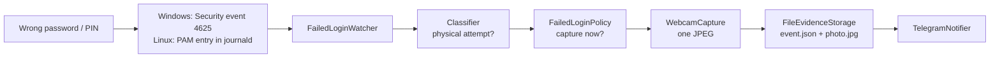

# Failed Login Security Monitor

[](https://github.com/DeniMiljevic/SecurityMonitor/actions/workflows/ci.yml)

A background service for **Windows and Linux** that detects failed login attempts on your own PC, tries to take a webcam photo, saves the evidence locally and sends a notification to your phone via Telegram.

On Windows it runs as a **Windows Service** from the moment the PC starts, keeps an index of incidents in a local **SQLite** database and offers a read-only **local API** with a browser **dashboard** (PC Guardian).

On a dual-boot PC it can also act as a **login gate**: the PC always starts Linux, and a successful login by a configured user restarts the PC into Windows.

Built with C# / .NET 10 as a learning project, using only documented operating system mechanisms: the Windows Security event log, Windows Services, named pipes and file permissions (ACLs), Linux PAM entries in the systemd journal, systemd, UEFI boot variables, the Windows `MediaCapture` camera API and the Telegram Bot API.

## What it does

When someone types a wrong password or PIN on the lock or login screen:

```
[20:59:24 INF] Relevant failed login detected: Pin, user (Unknown)
[20:59:24 WRN] Failed login threshold reached (1/1)
[20:59:24 INF] Attempting webcam capture
[20:59:25 INF] Photo captured (257 KB) from USB 2.0 Camera
[20:59:25 INF] Webcam capture succeeded
[20:59:25 INF] Evidence saved to C:\ProgramData\SecurityMonitor\Evidence\2026-11-24\20-59-23
[20:59:26 INF] Telegram notification sent
```

This is a wrong PIN on the lock screen of a real PC with a USB webcam, with the app running in the user's session. The Windows Service detects the same attempt and sends the same notification, but cannot take the photo (see [Limitations](#limitations)).

A notification arrives on your phone, and each incident gets its own folder:

```
Evidence/
    2026-11-24/
        20-59-23/
            event.json
            photo.jpg      (only when a camera captured a photo)
```

`event.json` has common fields and a platform-specific block:

```json
{
  "timestamp": "2026-11-24T20:59:23.0427738+01:00",
  "authenticationMethod": "Pin",
  "userName": null,
  "sourceNetworkAddress": "127.0.0.1",
  "computerName": "Deni",
  "attemptsInWindow": 1,
  "captureSucceeded": true,
  "captureFailureReason": null,
  "photoFile": "photo.jpg",
  "windows": {
    "eventId": 4625,
    "logonType": 2,
    "domain": null,
    "failureStatus": "0xC000006D",
    "failureSubStatus": "0xC0000380",
    "workstationName": null
  }
}
```

Windows does not write the user name for a wrong PIN, so `userName` is `null`; the sub-status `0xC0000380` is how a wrong PIN is told apart from a wrong password. On Linux the block is `"linux"` with `service` (for example `cinnamon-screensaver`) and `terminal`.

## How it works



1. **Detection.**
   - Windows: subscribes to new **Event ID 4625** ("An account failed to log on") entries in the Security log.
   - Linux: follows the system journal (`journalctl --follow`, auth facility) and reads `pam_unix(...:auth): authentication failure` entries. If `journalctl` stops, it is started again automatically.
2. **Classification.** Only attempts made at the keyboard count:
   - Windows: Logon Type **2** (Interactive), **7** (Unlock) or **11** (CachedInteractive) from a local address. The Sub Status tells a wrong **PIN** (`0xC0000380`) from a wrong **password** (`0xC000006A`).
   - Linux: the login screen (`lightdm`) and the lock screen (`cinnamon-screensaver`) with no remote host.

   Network logons, services, scheduled tasks, Remote Desktop, `sudo` and `ssh` are ignored.
3. **Policy.** Configurable threshold, time window and cooldown decide when to capture. The default reacts to every relevant attempt.
4. **Capture.** One photo from the webcam: `MediaCapture` on Windows, `ffmpeg` (Video4Linux) on Linux. The camera is on only for that moment. Camera problems (no camera, camera busy, access denied, no response) are recorded as a failed capture and never crash the app.
5. **Evidence.** Saved as JSON, plus the photo when there is one. On Windows each incident also gets one row in a local SQLite database, which points to its evidence folder. The files are saved first, so a database problem never loses evidence. Diagnostic logs are kept separately.
6. **Notification.** A Telegram message, with the photo when there is one. A throttle prevents spam but never drops evidence.

## Windows: service, database and local API

```
                                        Session 0 (services)
 dashboard / curl          ┌───────────────────────────────┐        ┌────────────────────────────────────┐
 (your account) ──HTTP──▶  │ SecurityMonitorApi            │──pipe─▶│ SecurityMonitor                    │
 127.0.0.1:5788 + token    │ NT SERVICE\SecurityMonitorApi │        │ LocalSystem                        │
                           │ no access to data             │        │ Security log, evidence, SQLite     │
                           └───────────────────────────────┘        └────────────────────────────────────┘
```

- **`SecurityMonitor`** is the monitoring service. It runs as LocalSystem because only administrators can read the Security log, and it starts with Windows, so it also sees wrong PINs on the sign-in screen before anyone has signed in.
- **`SecurityMonitorApi`** is a separate, read-only HTTP API for the dashboard. It runs under its own virtual account `NT SERVICE\SecurityMonitorApi`, which has no administrator rights and cannot open the database, the evidence or `secrets.json`. If the API ever had a bug, the attacker would get that weak account, not SYSTEM.
- The API asks the monitoring service over the named pipe `\\.\pipe\SecurityMonitor.Monitor` (JSON-RPC with [StreamJsonRpc](https://github.com/microsoft/vs-streamjsonrpc)). The pipe's ACL lets only the API account connect, not even administrators. The monitoring service creates the pipe with `FirstPipeInstance`, so it refuses to share the name with a program that created it first.
- The API listens only on `127.0.0.1:5788` and checks three things on every request: the `Host` header must be `localhost` or `127.0.0.1` (blocks DNS rebinding from web pages), a `Bearer` token must match (constant-time comparison), and if the token file is missing every request is rejected.
- The monitoring service creates the token (32 random bytes) at `C:\ProgramData\SecurityMonitor\Api\api-token` and sets its permissions on every start: SYSTEM and Administrators full control, the API account and the users in `Api.DashboardUsers` read only. A new token: delete the file and restart both services.

| Endpoint | Returns |
|---|---|
| `GET /api/status` | API version and start time, and the monitoring service's version, start time and incident count (`"monitor": null` when it cannot be reached) |
| `GET /api/incidents?take=50` | The newest incidents first, `take` between 1 and 200 (400 otherwise, 503 when the monitoring service cannot be reached). Times are in UTC |

```powershell
$token = Get-Content C:\ProgramData\SecurityMonitor\Api\api-token
curl.exe -s http://127.0.0.1:5788/api/incidents?take=5 -H "Authorization: Bearer $token"
```

## Dashboard (PC Guardian)

A browser dashboard for the local API, in `ui/pc-guardian` (React, TypeScript, Vite, Tailwind CSS, TanStack Query). It shows whether the monitoring service is running, how many incidents there are and the newest incidents in your local time, and it refreshes every 10 seconds and when you come back to the window. A desktop app (Tauri) is planned; for now the dashboard runs from the Vite development server.

```
browser ──/api/status──▶ Vite dev server (your account) ──+ token──▶ SecurityMonitorApi ──pipe──▶ SecurityMonitor
localhost:5173            reads the token file                       127.0.0.1:5788
```

The browser never sees the API token. The dev server reads the token file and adds the `Authorization` header when it forwards `/api/*` requests to the API, so no script on the page can read it, and the API needs no CORS. The dev server listens only on this PC.

Requirements: [Node.js](https://nodejs.org) 26 LTS, both services running, and your Windows user in `Api.DashboardUsers`, so the dev server can read the token. In Windows PowerShell, npm's scripts need `Set-ExecutionPolicy -Scope CurrentUser RemoteSigned` once.

```powershell
cd ui\pc-guardian
npm ci
npm run dev
```

Then open http://localhost:5173. `PC_GUARDIAN_TOKEN_FILE` points the dev server to another token file.

| Script | What it does |
|---|---|
| `npm run dev` | Development server with the API proxy, reloads on save |
| `npm test` | Vitest tests (jsdom, Testing Library) with a fake API |
| `npm run lint` | ESLint |
| `npm run format` / `npm run format:check` | Prettier: format the code / check that it is formatted |
| `npm run build` | Type check and production build into `dist/` |

## Dual-boot login gate (Linux)

```
Power on → GRUB → Linux login screen (monitor already running as a systemd service)
   ├── wrong password (any user)      → evidence + Telegram
   ├── configured user (e.g. "deni")  → efibootmgr --bootnext <Windows> → reboot → Windows (once)
   └── any other user (e.g. "admin")  → stays in Linux
Windows shuts down or restarts        → BootNext is used up → Linux again
```

- A successful login is read from the journal: `pam_unix(lightdm:session): session opened for user ...`. Greeter, `systemd-user`, `sudo` and `cron` sessions and system accounts (uid < 1000) are ignored. Unlocking the lock screen does not open a session, so it never switches.
- The switch uses the UEFI **BootNext** variable, so Windows is started directly by the firmware (not chained through GRUB).
- **Fail-safe:** if anything goes wrong (no Windows entry, `efibootmgr` fails, the reboot fails, the service stops during the delay), the pending switch is cleared and the PC stays in Linux.
- **DryRun** mode logs what would happen without touching the firmware.
- **Startup check:** when the service starts it checks that Linux is first in the UEFI boot order and that the Windows entry exists, and sends a Telegram warning if not (retried while the network comes up).
- **Windows-side check:** Windows updates can put Windows Boot Manager first in the UEFI boot order, and then Linux never starts to notice. With `DualBoot.Enabled` on Windows too, the Windows app reads the `BootOrder` and `Boot####` UEFI variables at startup (read-only, through the documented `GetFirmwareEnvironmentVariableEx` API) and sends a Telegram warning if Windows is the first active entry, with the `bcdedit` command to fix it. It never changes the boot order itself.
- Off by default. Nothing is registered and no second journal reader runs unless `DualBoot.Enabled` is `true`.

Status: verified end to end in a VirtualBox VM (Linux Mint 22.3 + Windows 11, UEFI). Not yet deployed on real hardware.

## Limitations

These are platform limits or known gaps, not hidden bugs:

- **Windows: no photo from the service.** A Windows Service runs in Session 0, which has no access to the camera. The service still detects every attempt, saves the evidence and sends the Telegram message, but records `Camera is not available to a Windows Service (Session 0)`. A small helper in the user's session that takes the photo is planned. Started from Visual Studio in your own session, the app does take photos, also while the PC is locked (verified with a USB webcam).
- **Windows: wrong PINs have no user name** in the event log. **Biometric failures** usually do not create event 4625.
- **Windows: camera privacy settings apply** to the photo from the user session.
- **Windows: incidents saved before the database was added** have evidence folders but no row in the database, so the API does not list them.
- **Linux: webcam capture** is implemented with `ffmpeg` and unit tested, but has not yet been verified with a real webcam.
- **Linux: other desktops.** Service names are those of Linux Mint Cinnamon (`lightdm`, `cinnamon-screensaver`). Another display manager or screen locker needs its name added.
- **Linux: if `journalctl` crashes**, it is restarted after 5 s and entries written during that gap are not seen.
- **The login gate is not a hard security boundary on its own.** Choosing Windows in the GRUB menu or the firmware boot menu, or booting from USB, skips Linux. Close these with a GRUB password (see [Hardening the boot](#hardening-the-boot-grub-password)), a firmware (BIOS) admin password, a disabled boot menu / USB boot, and BitLocker for the Windows data. Someone who can open the case can always reset the firmware.
- Evidence, the database and secrets are not encrypted at rest. Access is limited to administrators (Windows) and root (Linux), but anyone with those rights, or with the disk in another computer, can read them. BitLocker or LUKS covers the second case.

## Architecture

```
src/
  SecurityMonitor.Core                    Models, interfaces, classifiers, policies, monitors.
                                          No OS-specific code, fully unit tested.
  SecurityMonitor.Infrastructure.Common   Shared hosting (Worker, DI), file evidence storage,
                                          Telegram notifier, UEFI boot entry decoding and
                                          boot order check.
  SecurityMonitor.Infrastructure.Data     SQLite incident index (EF Core, migrations applied at start),
                                          incident queries.
  SecurityMonitor.Infrastructure.Windows  Event log watcher, MediaCapture webcam, UEFI variable
                                          reader (P/Invoke), file and pipe permissions (ACLs).
  SecurityMonitor.Infrastructure.Linux    Journal follower and parser, EFI BootNext switcher.
  SecurityMonitor.Contracts               What the API may ask the monitoring service over the
                                          named pipe. No dependencies.
  SecurityMonitor.Host.Windows            Windows Service (Generic Host, Serilog, boot order check,
                                          API token, named pipe server).
  SecurityMonitor.Host.Linux              Linux systemd service (Generic Host, Serilog, dual boot).
  SecurityMonitor.Api                     Read-only local API (ASP.NET Core minimal APIs), its own
                                          Windows Service, named pipe client.
tests/
  SecurityMonitor.Tests                   xUnit tests with fake camera, ffmpeg, storage, notifier,
                                          boot switcher, command runner, UEFI variables and an
                                          in-memory SQLite database. Also run on Linux.
  SecurityMonitor.Tests.Windows           Windows host composition (every DI registration can be
                                          created) and the named pipe end to end.
  SecurityMonitor.Tests.Api               The real API in memory (WebApplicationFactory) with a
                                          fake monitoring service.
deploy/linux/
  securitymonitor.service                 systemd unit.
  update.sh                               Pull, test, publish and restart the service.
ui/pc-guardian/                           Dashboard: React, TypeScript, Vite, Tailwind CSS,
                                          TanStack Query; Vitest tests next to the components.
.github/workflows/
  ci.yml                                  GitHub Actions: build and test on Linux and Windows,
                                          check and test the dashboard.
```

All dependencies point towards `Core`; the API knows only `Contracts`, and the dashboard knows only the API. The decision logic is tested without real failed logins, a webcam, the event log, the journal, firmware or a network connection. For example, the boot switcher tests check that DryRun never calls `efibootmgr --bootnext` and that a failed reboot clears BootNext again.

`SecurityMonitor.Linux.slnf` is a solution filter with only the projects that build on Linux.

## Configuration

`appsettings.json` (next to the program) holds the defaults that are the same for everyone:

```json
"SecurityMonitor": {
  "FailedAttemptsBeforeCapture": 1,
  "AttemptWindowMinutes": 5,
  "CaptureCooldownMinutes": 0,
  "EvidenceDirectory": "/var/lib/securitymonitor/evidence"
},
"Telegram": {
  "Enabled": true,
  "NotificationCooldownMinutes": 0
},
"LinuxWebcam": {
  "Device": "/dev/video0",
  "WarmupSeconds": 1,
  "TimeoutSeconds": 10
},
"DualBoot": {
  "Enabled": false,
  "DryRun": true,
  "SwitchToWindowsUsers": [],
  "WindowsBootEntry": "Windows Boot Manager",
  "RebootDelaySeconds": 5
}
```

| Setting | Meaning |
|---|---|
| `FailedAttemptsBeforeCapture` | Relevant failed attempts needed to trigger a capture |
| `AttemptWindowMinutes` | How long an attempt counts toward the threshold |
| `CaptureCooldownMinutes` | Minimum time between two captures, `0` = every time |
| `EvidenceDirectory` | Where incidents are saved (environment variables are expanded) |
| `Telegram.Enabled` | Phone notifications on or off |
| `Telegram.NotificationCooldownMinutes` | Minimum time between two messages, `0` = every time |
| `LinuxWebcam.Device` | Linux only: camera device, usually `/dev/video0` |
| `LinuxWebcam.WarmupSeconds` | Wait before the photo, so the camera can adjust to the light |
| `LinuxWebcam.TimeoutSeconds` | Give up if the camera does not answer in time |
| `DualBoot.Enabled` | Linux: turn the login gate on. Windows: check at startup that Windows has not put itself first in the UEFI boot order (needs administrator rights) |
| `DualBoot.DryRun` | Only log what would happen, never change the boot order |
| `DualBoot.SwitchToWindowsUsers` | Linux users whose login restarts the PC into Windows |
| `DualBoot.WindowsBootEntry` | Name of the Windows UEFI entry, as shown by `efibootmgr` |
| `DualBoot.RebootDelaySeconds` | Pause between setting BootNext and rebooting |

Windows only, in the monitoring service's `appsettings.json`:

```json
"Api": {
  "TokenFile": "%ProgramData%\\SecurityMonitor\\Api\\api-token",
  "ServiceAccount": "NT SERVICE\\SecurityMonitorApi",
  "DashboardUsers": []
},
"ConnectionStrings": {
  "SecurityMonitor": "Data Source=%ProgramData%\\SecurityMonitor\\securitymonitor.db"
}
```

| Setting | Meaning |
|---|---|
| `Api.TokenFile` | Where the monitoring service creates the API token (the API reads the same path from its own `appsettings.json`) |
| `Api.ServiceAccount` | The account that may read the token and connect to the named pipe |
| `Api.DashboardUsers` | Windows users who may read the token, for example to use a dashboard. Empty in the repository; set it in `secrets.json` |
| `ConnectionStrings.SecurityMonitor` | The SQLite incident database |

The API (`C:\Program Files\SecurityMonitorApi\appsettings.json`) listens on `http://127.0.0.1:5788` (`Kestrel`) and accepts only the hosts in `AllowedHosts` (`localhost;127.0.0.1`).

**Personal settings and secrets are never kept in the repository.**

| | Windows | Linux |
|---|---|---|
| Secrets (bot token, chat id) | `C:\ProgramData\SecurityMonitor\secrets.json` (administrators only, edit with Notepad run as administrator) | `/etc/securitymonitor/secrets.json` (root, `chmod 600`) |
| Personal settings | n/a | `/etc/securitymonitor/settings.json` (root) |

```json
{ "Telegram": { "BotToken": "your-bot-token", "ChatId": "your-telegram-chat-id" } }
```

The Windows `secrets.json` also holds the machine's own settings, for example the boot order check on a dual-boot PC and the users who may use the dashboard:

```json
{
  "Telegram": { "BotToken": "your-bot-token", "ChatId": "your-telegram-chat-id" },
  "DualBoot": { "Enabled": true },
  "Api": { "DashboardUsers": [ "your-windows-user" ] }
}
```

Example Linux `settings.json`:

```json
{ "DualBoot": { "Enabled": true, "DryRun": false, "SwitchToWindowsUsers": ["deni"] } }
```

## Installation: Windows

Requirements: Windows 10 (2004) or 11, .NET 10 runtime, administrator rights, optionally a Telegram account.

1. **Check that failed logons are audited.** Lock the PC, type a wrong PIN, unlock, open Event Viewer → Windows Logs → Security and filter for Event ID **4625**. If nothing appears, enable *Audit Logon → Failure* in Local Security Policy.
2. **Telegram (optional).** Create a bot with **@BotFather** (`/newbot`), send it a message, get your chat id from **@userinfobot**, and put both in `secrets.json`.
3. **Publish both programs.** In Visual Studio (as administrator), Publish → Folder, Release, framework-dependent, win-x64:
   - `SecurityMonitor.Host.Windows` → `C:\Program Files\SecurityMonitor`
   - `SecurityMonitor.Api` → `C:\Program Files\SecurityMonitorApi` (a separate folder, because both have an `appsettings.json`)
4. **Create the services** in PowerShell run as administrator. `--%` passes the rest of the line to `sc.exe` unchanged; without it PowerShell 5.1 breaks the quotes around the path. The space after each `=` is required, and the quoted path prevents the *unquoted service path* weakness.
   ```powershell
   sc.exe --% create SecurityMonitor binPath= "\"C:\Program Files\SecurityMonitor\SecurityMonitor.Host.Windows.exe\"" start= auto DisplayName= "SecurityMonitor"

   New-EventLog -LogName Application -Source SecurityMonitor.Api
   sc.exe --% create SecurityMonitorApi binPath= "\"C:\Program Files\SecurityMonitorApi\SecurityMonitor.Api.exe\"" obj= "NT SERVICE\SecurityMonitorApi" start= auto depend= SecurityMonitor DisplayName= "SecurityMonitor API"

   sc.exe start SecurityMonitor
   sc.exe start SecurityMonitorApi
   sc.exe qc SecurityMonitorApi
   ```
   `qc` should show the path in quotes, `SERVICE_START_NAME : NT SERVICE\SecurityMonitorApi` and `DEPENDENCIES : SecurityMonitor`. The monitoring service runs as LocalSystem. The API waits for it (`depend=`), because it reads the token once when it starts. The API's warnings and errors go to Event Viewer → Windows Logs → Application, source `SecurityMonitor.Api`.
5. **Dashboard users (optional).** Add `"Api": { "DashboardUsers": [ "your-windows-user" ] }` to `secrets.json` (the name `whoami` shows) and restart `SecurityMonitor`. That user can then read the token without administrator rights.
6. **Dual boot (optional).** Add `"DualBoot": { "Enabled": true }` to `secrets.json`. The log then shows `Boot configuration OK` at startup, or a warning if Windows is first in the UEFI boot order.
7. **Check.** Read the log from PowerShell run as administrator (see the note below):
   ```powershell
   Get-Content C:\ProgramData\SecurityMonitor\Logs\diagnostics-<yyyyMMdd>.log -Tail 20
   ```
   It should contain `Watching the Security log`, `API token is ready`, `Monitor pipe SecurityMonitor.Monitor is open for NT SERVICE\SecurityMonitorApi` and `Incident database is up to date`. Then lock the PC, type a wrong PIN, and the Telegram message arrives.

**Updating:** stop the API first, because Windows does not stop a service that another running service depends on (error 1051):

```powershell
sc.exe stop SecurityMonitorApi
sc.exe stop SecurityMonitor
# publish both projects again
sc.exe start SecurityMonitor
sc.exe start SecurityMonitorApi
```

**Reading the data folder:** do not open `C:\ProgramData\SecurityMonitor` in Explorer. Explorer runs without administrator rights, and its *Continue* button permanently gives your account full access to the folder. The service takes that away again at the next start, but until then any program you run could read the evidence. Use PowerShell run as administrator instead.

**Removing:** `sc.exe stop SecurityMonitorApi`, `sc.exe stop SecurityMonitor`, `sc.exe delete SecurityMonitorApi`, `sc.exe delete SecurityMonitor`, then delete the two folders in `C:\Program Files` and, if you no longer need the evidence, `C:\ProgramData\SecurityMonitor`. Both services are normal, visible services in `services.msc`.

**Moving from the earlier sign-in task:** earlier versions started at sign-in through Task Scheduler. Disable or delete that task, otherwise two monitors run side by side.

## Installation: Linux

Tested on Linux Mint 22.3 Cinnamon. Requirements: .NET 10 SDK (`sudo apt install dotnet-sdk-10.0`), `ffmpeg` for the webcam (`sudo apt install ffmpeg`), root rights, `efibootmgr` for the login gate.

```bash
git clone https://github.com/DeniMiljevic/SecurityMonitor.git
cd SecurityMonitor
dotnet test SecurityMonitor.Linux.slnf

# secrets (only root can read them)
sudo mkdir -p /etc/securitymonitor
sudo nano /etc/securitymonitor/secrets.json
sudo chmod 600 /etc/securitymonitor/secrets.json

# publish and install
dotnet publish src/SecurityMonitor.Host.Linux -c Release -o ./publish
sudo mkdir -p /opt/securitymonitor /var/lib/securitymonitor /var/log/securitymonitor
sudo cp -r ./publish/. /opt/securitymonitor/

# systemd service (starts before the login screen)
sudo cp deploy/linux/securitymonitor.service /etc/systemd/system/
sudo systemctl daemon-reload
sudo systemctl enable --now securitymonitor
journalctl -u securitymonitor -f
```

**Updating:** run the update script. It pulls the latest code, runs the tests, publishes, and restarts the service only if the tests pass. It stops the service before copying, because overwriting the files of a running .NET program can crash it.

```bash
./deploy/linux/update.sh
```

When updating from a version before `UMask=0077`, make the existing evidence and logs root-only once: `sudo chmod -R go-rwx /var/lib/securitymonitor /var/log/securitymonitor`.

**Logs:** the service sends each message to the journal with its real priority, so warnings and errors are highlighted and can be filtered:

```bash
journalctl -u securitymonitor -f                                  # follow everything
journalctl -u securitymonitor -p warning --since "7 days ago"     # only problems
```

**Login gate:** create `/etc/securitymonitor/settings.json` (above), start with `"DryRun": true`, log out and back in as the configured user and check the log for `DryRun: would set BootNext to ...`. Make sure GRUB stays first in the UEFI boot order (`efibootmgr` → `BootOrder`) and keep a second Linux user that does not switch, for maintenance.

The service is a normal, visible systemd unit: `systemctl status securitymonitor`, `sudo systemctl disable --now securitymonitor` removes it from startup.

## Hardening the boot: GRUB password

Without a GRUB password, anyone at the keyboard can open the GRUB menu (Esc while it is hidden) and:

- pick **Windows Boot Manager** and skip Linux and the login gate,
- press **e** on the Linux entry and boot with `init=/bin/bash`, which gives a root shell without any password,
- press **c** for the GRUB console, or start **recovery mode**.

The setup below keeps the normal Linux start password-free and locks everything else behind a GRUB superuser. The GRUB user has nothing to do with the Linux users. Verified in the VM.

```
Linux Mint (default)      → starts without a password (--unrestricted), but e / c need the GRUB password
Advanced options/recovery → GRUB password
Windows Boot Manager      → GRUB password (the owner's fallback way into Windows)
UEFI Firmware Settings    → GRUB password
```

The login gate itself is not affected: `BootNext` starts Windows directly from the firmware and never goes through GRUB.

1. **Back up** (to your home folder, not to `/etc/grub.d/`, because `update-grub` runs every executable file in that folder):
   ```bash
   sudo cp /etc/default/grub ~/grub.default.bak
   sudo cp /etc/grub.d/10_linux ~/10_linux.bak
   ```
2. **Create the password hash.** GRUB always uses the **US keyboard layout**, so use a long password of lowercase letters and digits only (no `z`/`y`, no special characters), otherwise it may not match what you type at boot. Keep it in a password manager and do not share the hash.
   ```bash
   grub-mkpasswd-pbkdf2
   ```
3. **Define the GRUB superuser** in `/etc/grub.d/01_password` (then `sudo chmod 700 /etc/grub.d/01_password`):
   ```sh
   #!/bin/sh
   cat <<'EOF'
   set superusers="grubadmin"
   password_pbkdf2 grubadmin grub.pbkdf2.sha512.10000.<your hash>
   EOF
   ```
4. **Let the normal Linux entry start without a password** by adding `--unrestricted` to its class line, and **make Linux the fixed default** (with `GRUB_DEFAULT=saved`, a remembered Windows entry would stop every boot at the password prompt):
   ```bash
   sudo sed -i 's/^CLASS="--class gnu-linux --class gnu --class os"$/CLASS="--class gnu-linux --class gnu --class os --unrestricted"/' /etc/grub.d/10_linux
   sudo sed -i 's/^GRUB_DEFAULT=saved$/GRUB_DEFAULT=0/' /etc/default/grub
   grep -n '^CLASS=' /etc/grub.d/10_linux
   grep -n '^GRUB_DEFAULT' /etc/default/grub
   ```
5. **Apply and check:**
   ```bash
   sudo update-grub
   sudo grep -n -E 'superusers|menuentry |submenu ' /boot/grub/grub.cfg | cut -c1-110
   ```
   Only the main Linux entry should have `--unrestricted`.
6. **Test after a restart:** the PC starts Linux without a prompt; in the menu, **e**, **c**, *Advanced options*, *UEFI Firmware Settings* and *Windows Boot Manager* ask for the GRUB user and password, a wrong one returns to the menu, and the right one works. GRUB forgets the login at the next restart.

Notes:

- `/etc/grub.d/10_linux` belongs to the GRUB package. If an update asks whether to keep the modified file, keep it, and check the `CLASS=` line again after larger updates.
- GRUB cannot protect the **firmware boot menu** (F12) or booting from USB. Lock those with a firmware (BIOS) admin password.

## Privacy and safety

- The app **never reads, stores or intercepts passwords or PINs**. Neither Windows nor PAM writes them to the logs, and the evidence format has no field for them.
- It does not replace or hook any login screen, does not modify the PAM stack and does not bypass any operating system protection.
- Photos, logs, the bot token and the chat id stay on the local disk. None of them are committed to git.
- Only administrators can read them. On Windows the app sets the permissions of `C:\ProgramData\SecurityMonitor` (and of the evidence folder, if it is elsewhere) on every start: only SYSTEM and Administrators, nothing inherited from `C:\ProgramData`, so the bot token and photos are not readable by other users. `secrets.json` and the API token get their own permissions that do not depend on the folder, so a permission added to the folder never reaches them. On Linux the systemd unit sets `UMask=0077`, so everything the service creates is readable only by root.
- The local API only reads. It cannot change settings, delete evidence or stop monitoring, it is reachable only from this PC, and it runs under an account that cannot open the data itself. Anyone who can read the API token (administrators and the users in `Api.DashboardUsers`) can list the incidents through it.
- It is meant for monitoring **your own** computer.

## Running the tests

Visual Studio: **Test → Run All Tests** (175 tests). On Linux: `dotnet test SecurityMonitor.Linux.slnf` (only the projects that build on Linux). The dashboard: `npm test` in `ui/pc-guardian` (11 tests).

They cover the Windows and Linux classifiers, the journal and `efibootmgr` parsers (with real captured output), the UEFI boot entry and boot order decoding, the capture policy, the notification throttle, the dual-boot policy and monitor, the boot switcher (DryRun, missing Windows entry, failed `--bootnext`, failed reboot), the boot order checks on both systems (including an inactive Linux entry that the firmware skips), the failed-login monitor (a camera, storage or notifier failure does not crash it), the incident database (a database failure still keeps the evidence, times stay in UTC, the model matches the latest migration), the Windows host's DI registrations, the local API (token, foreign host, missing token file, `take` limits, monitoring service unreachable), the named pipe (a real pipe end to end, its permissions, and refusing a pipe name that someone else took first) and the dashboard (the API client, the status cards and the incident table, including an unreachable API and an empty list).

Every push and pull request to `main` is built and tested by GitHub Actions in three jobs: Ubuntu (the Linux solution filter), Windows (the whole solution, including the Windows host) and the dashboard (`npm ci`, formatting, lint, build and tests). The badge at the top shows the result of the latest run.

## Status and roadmap

- [x] Windows: detect failed logins (event 4625), PIN vs password
- [x] Windows: webcam capture with graceful failure, runs as a Windows Service
- [x] Evidence storage (JSON + JPEG) and Telegram notifications
- [x] Linux: detect failed logins on the login and lock screen (journald / PAM)
- [x] Linux: systemd service that starts before the login screen
- [x] Dual-boot login gate via UEFI BootNext, verified in a VM
- [x] Windows webcam capture verified with a real webcam
- [x] Linux webcam capture (`ffmpeg` / V4L2), unit tested
- [ ] Linux webcam capture verified with a real webcam
- [x] Startup check of the UEFI boot order and the Windows entry, with a Telegram warning
- [x] Update script for Linux and GitHub Actions CI (Linux and Windows)
- [x] Windows-side check that Windows has not put itself first in the boot order, verified in the VM and read on real hardware
- [x] GRUB password: Linux starts without it, everything else needs it, verified in the VM
- [ ] Firmware (BIOS) password and deployment on real hardware
- [ ] Windows: report failed attempts that happened while the app was not running
- [x] Restrict evidence, logs and secrets to administrators (Windows) and root (Linux)
