# Failed Login Security Monitor

A small Windows background app that detects failed PIN and password attempts on a **locked** PC, tries to take a webcam photo, saves the evidence locally, and sends a notification to your phone via Telegram.

Built with C# / .NET 10 as a learning project, using only documented Windows mechanisms: the Security event log, Task Scheduler, the `MediaCapture` camera API and the Telegram Bot API.

## What it does

When someone types a wrong PIN or password on your lock screen:

```
[22:01:29 INF] Relevant failed login detected: Pin, LogonType 2, user (unknown)
[22:01:29 WRN] Failed login threshold reached (1/1)
[22:01:29 INF] Attempting webcam capture
[22:01:29 WRN] Webcam capture failed: No camera found
[22:01:29 INF] Evidence saved to C:\ProgramData\SecurityMonitor\Evidence\2026-10-12\22-01-29
[22:01:30 INF] Telegram notification sent
```

A notification arrives on your phone, and each incident gets its own folder:

```
C:\ProgramData\SecurityMonitor\Evidence\
    2026-10-12\
        22-01-29\
            event.json
            photo.jpg      (only when a camera captured a photo)
```

`event.json` example:

```json
{
  "timestamp": "2026-10-12T22:01:29.1334291+02:00",
  "eventId": 4625,
  "logonType": 2,
  "authenticationMethod": "Pin",
  "userName": null,
  "domain": null,
  "failureStatus": "0xC000006D",
  "failureSubStatus": "0xC0000380",
  "sourceNetworkAddress": "127.0.0.1",
  "workstationName": null,
  "computerName": "Deni",
  "attemptsInWindow": 1,
  "captureSucceeded": false,
  "captureFailureReason": "No camera found",
  "photoFile": null
}
```

## How it works

```mermaid
flowchart LR
    A[Wrong PIN on lock screen] --> B[Windows writes<br/>Security event 4625]
    B --> C[WindowsFailedLoginWatcher<br/>EventLogWatcher]
    C --> D[FailedLoginClassifier<br/>physical attempt?]
    D --> E[FailedLoginPolicy<br/>capture now?]
    E --> F[WindowsWebcamCapture<br/>one JPEG]
    F --> G[FileEvidenceStorage<br/>event.json + photo.jpg]
    G --> H[TelegramNotifier<br/>message + photo to phone]
```



1. **Detection.** The app subscribes to new **Event ID 4625** ("An account failed to log on") entries in the Windows Security log.
2. **Classification.** Only attempts that look like someone at the keyboard count:
   - Logon Type **2** (Interactive), **7** (Unlock) or **11** (CachedInteractive)
   - local source address (empty, `127.0.0.1` or `::1`)

   Network logons, services, scheduled tasks and Remote Desktop are ignored. The Sub Status code tells a wrong **PIN** (`0xC0000380`) from a wrong **password** (`0xC000006A`).
3. **Policy.** Configurable threshold, time window and cooldown decide when to capture. The default takes a photo on every relevant failed attempt.
4. **Capture.** One photo from the default webcam via `Windows.Media.Capture`. The camera is on only during the capture. Camera problems (no camera, access denied, camera busy) are recorded as a failed capture and never crash the app.
5. **Evidence.** The incident is saved as JSON, plus the photo when there is one. Diagnostic logs are kept separately in `C:\ProgramData\SecurityMonitor\Logs`.
6. **Notification.** A Telegram message is sent to your phone, with the photo attached when one was captured. A throttle prevents spam; it never drops evidence, only the extra messages.

## Limitations

These are limits of Windows, not bugs:

- **It only works while you are signed in and the PC is locked.** The app runs inside your Windows session. After a restart or sign-out, attempts on the sign-in screen are not seen, because nobody is signed in yet.
- **No photo from a Windows Service.** Services run in Session 0 and cannot reliably use the camera, which is why this is a user-session app started by Task Scheduler and not a service.
- **Wrong PINs have no user name.** Windows logs them with an empty account name.
- **Biometric failures** (face, fingerprint) usually do not create event 4625 and are not detected.
- **Camera privacy settings apply.** If "Let desktop apps access your camera" is off, no photo is taken and the reason is saved in `event.json`.
- Evidence in `C:\ProgramData` is readable by all local users by default.

## Architecture

```
src/
  SecurityMonitor.Core            Domain models, interfaces, classifier, policy,
                                  monitor, notification throttle. No Windows-specific
                                  code, fully unit tested.
  SecurityMonitor.Infrastructure  Windows / external implementations: event log watcher,
                                  MediaCapture webcam, file evidence storage, Telegram notifier.
  SecurityMonitor.Host            Generic Host, BackgroundService, DI, Serilog.
tests/
  SecurityMonitor.Tests           xUnit tests with fake camera, storage and notifier.
```

All dependencies point towards `Core`. The decision logic can be tested without real failed logins, a webcam, the event log or a network connection. Adding a new notification channel (e.g. email) means one new class behind `INotifier`, with nothing else changed.

## Configuration

`appsettings.json`, next to the `.exe`:

```json
"SecurityMonitor": {
  "FailedAttemptsBeforeCapture": 1,
  "AttemptWindowMinutes": 5,
  "CaptureCooldownMinutes": 0,
  "EvidenceDirectory": "%ProgramData%\\SecurityMonitor\\Evidence"
},
"Telegram": {
  "Enabled": true,
  "ChatId": "your-telegram-chat-id",
  "NotificationCooldownMinutes": 0
}
```

| Setting | Meaning |
|---|---|
| `FailedAttemptsBeforeCapture` | Relevant failed attempts needed to trigger a capture |
| `AttemptWindowMinutes` | How long an attempt counts toward the threshold |
| `CaptureCooldownMinutes` | Minimum time between two captures, `0` = capture every time |
| `EvidenceDirectory` | Where incidents are saved, environment variables are expanded |
| `Telegram.Enabled` | Turn phone notifications on or off |
| `Telegram.ChatId` | Who receives the message (your own Telegram chat id) |
| `Telegram.NotificationCooldownMinutes` | Minimum time between two messages, `0` = notify every time |

The **bot token is a secret** and is never kept in `appsettings.json` or in git. In development it lives in User Secrets; the published app reads it from `C:\ProgramData\SecurityMonitor\secrets.json`:

```json
{ "Telegram": { "BotToken": "your-bot-token" } }
```

## Installation

Requirements: Windows 10 (2004) or Windows 11, .NET 10 runtime, administrator rights. For phone notifications, a Telegram account.

1. **Check that failed logons are audited.** Lock the PC, type a wrong PIN, unlock, then open Event Viewer -> Windows Logs -> Security and filter for Event ID **4625**. If nothing appears, enable *Audit Logon -> Failure* in Local Security Policy.
2. **Set up Telegram (optional).** In Telegram, create a bot with **@BotFather** (`/newbot`) and copy the token. Send your bot any message. Get your chat id from **@userinfobot**. Put the token in `secrets.json` (above) and the chat id in `appsettings.json`.
3. **Publish.** In Visual Studio (run as administrator): right-click `SecurityMonitor.Host` -> Publish -> Folder -> `C:\Program Files\SecurityMonitor`, Release, Framework-dependent, win-x64.
4. **Start automatically at sign-in.** In Task Scheduler -> Create Task:
   - General: *Run only when user is logged on*, *Run with highest privileges*
   - Trigger: *At log on* of your user
   - Action: program `"C:\Program Files\SecurityMonitor\SecurityMonitor.Host.exe"`, start in `C:\Program Files\SecurityMonitor`
   - Settings: untick *Stop the task if it runs longer than 3 days*, restart on failure, *Do not start a new instance*
5. Sign out and back in. `SecurityMonitor.Host.exe` should be visible in Task Manager -> Details.

The published app has no window. It is not hidden: it shows up in Task Manager and Task Scheduler, where it can be stopped. Logs are in `C:\ProgramData\SecurityMonitor\Logs`.

Each user installs on their own PC with their own bot token and chat id; secrets are never shared.

## Privacy and safety

- The app **never reads, stores or intercepts passwords or PINs**. Windows does not write them to the event log, and the evidence format has no field for them.
- It does not replace or hook the Windows sign-in screen and does not bypass any Windows protection.
- Photos, logs and the bot token stay on the local disk; nothing is committed to git.
- It is meant for monitoring **your own** computer.

## Running the tests

Open the solution in Visual Studio and run **Test -> Run All Tests** (39 tests). They cover the classifier, the policy (threshold, time window, cooldown, invalid settings), the notification throttle, and the monitor (a camera, storage or notifier failure does not crash it).

## Status and roadmap

- [x] Detect failed logins from the Security log
- [x] Classify physical attempts, PIN vs password
- [x] Configurable capture policy
- [x] Webcam capture implemented, with graceful failure (handles no camera / access denied)
- [x] Evidence storage (JSON + JPEG)
- [x] Automatic start at sign-in
- [x] Telegram notification (text verified end to end)
- [ ] Verified end to end with a real webcam (photo in evidence and in Telegram)
- [ ] Detection on the sign-in screen before anyone logs in (Windows Service)
- [ ] Restrict evidence folder access to administrators
